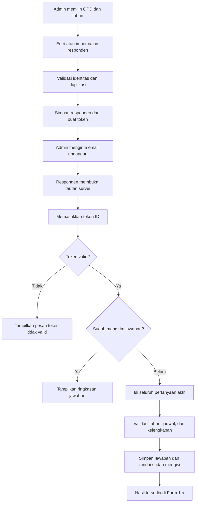

# Perubahan Alur Pengisian Kuesioner CEE

Tanggal dokumentasi: 30 September 2026.

Dokumen ini menjelaskan alur terbaru pengisian kuesioner persepsi lingkungan pengendalian (CEE). Responden didaftarkan terlebih dahulu oleh admin, menerima undangan melalui email, lalu mengisi survei menggunakan token tanpa login. Pengiriman undangan WhatsApp dinonaktifkan.

## 1. Ringkasan perubahan

| Komponen | Alur sebelumnya | Alur terbaru |
|---|---|---|
| Pendataan responden | Dibuat saat pegawai mengirim survei | Admin mendaftarkan calon responden sebelum pengisian |
| Identitas | Nama dan jabatan diisi responden, email dari akun Google | Admin mengisi NIP, nama, jabatan, email, dan no HP |
| Akses | Login Google/Firebase | Token pribadi dari email undangan, tanpa login |
| OPD dan tahun | Dipilih/dikirim melalui formulir responden | Mengikuti data undangan; tidak dapat diubah responden |
| Undangan | Tautan publik dibagikan kepada pegawai | Admin mengirim email berisi tautan dan token |
| Tampilan Form 1.a | Data responden dan matriks dalam satu halaman | Tab Daftar Calon Responden dan Hasil Kuesioner |
| Entri massal | Entri manual | Entri manual atau impor Excel |

## 2. Diagram alur



## 3. Panduan admin

### Persiapan

1. Login sebagai admin.
2. Atur tahun aktif dan jadwal pengisian pada menu Pengaturan.
3. Buka **Form 1.a — Kuesioner CEE (Persepsi)** dan pilih OPD serta tahun tujuan.
4. Buka tab **Daftar Calon Responden**.

### Entri manual

Klik **Tambah Responden**, lalu isi seluruh kolom berikut.

| Kolom | Ketentuan |
|---|---|
| NIP | Wajib; disimpan sebagai teks agar digit tetap utuh |
| Nama | Nama lengkap responden |
| Jabatan | Jabatan responden |
| Email | Alamat email valid untuk menerima undangan |
| No HP | Nomor kontak responden; tetap wajib meskipun WhatsApp dinonaktifkan |

Saat disimpan, sistem membuat kode responden R1, R2, dan seterusnya serta token pribadi. NIP atau email yang sudah terdaftar pada tahun yang sama ditolak, termasuk lintas OPD. Email dinormalisasi menjadi huruf kecil.

### Impor Excel

1. Klik **Import Excel → Unduh Template Excel**.
2. Isi sheet **Responden** dengan kolom berurutan: **NIP | Nama | Jabatan | Email | No HP | Kategori Jabatan**.
3. Gunakan format teks untuk NIP dan No HP. Jika Excel sudah membulatkan NIP atau menghapus nol awal, isi ulang dari sumber asli; mengganti format sel saja tidak mengembalikan digit yang hilang.
4. Unggah file `.xlsx`, maksimal **5 MB** dan **1.000 baris data**.
5. Klik **Import** dan periksa ringkasan serta nomor baris yang gagal.

Baris valid ditambahkan ke OPD dan tahun yang dipilih, dengan token otomatis. Baris kosong dilewati. Baris tidak lengkap, mengandung rumus, memiliki NIP/No HP numerik, atau duplikat dilewati dan dilaporkan. Duplikasi diperiksa terhadap data tahun tersebut dan baris sebelumnya dalam file. File yang tidak valid atau melebihi batas ditolak.

Impor tidak memperbarui responden lama dan tidak mengirim email otomatis. Perbaiki baris gagal, lalu impor kembali; data yang sudah berhasil akan dikenali sebagai duplikat.

### Edit dan hapus

Klik ikon **⋮** pada kolom aksi untuk membuka menu **Edit** dan **Hapus**.

- Sebelum responden mengirim survei, identitas dapat diedit dan responden dapat dihapus dengan konfirmasi.
- Jika email diubah, token diganti dan status undangan email direset. Kirim ulang undangan; token sebelumnya tidak berlaku.
- Sesudah survei dikirim, Edit dan Hapus pada daftar calon responden dinonaktifkan. Endpoint pengelolaan calon responden juga menolak kedua aksi tersebut.

Ketentuan ini berlaku pada pengelolaan calon responden. Menu admin **Rincian Hasil Survei** masih memiliki endpoint penghapusan hasil tersendiri; penguncian daftar calon responden bukan larangan penghapusan global di seluruh aplikasi.

### Mengirim undangan

Klik **Kirim Email Undangan**. Sistem memproses seluruh responden yang belum mengisi pada OPD dan tahun terpilih. Responden yang sudah mengisi dilewati.

Email memuat sapaan, tujuan survei, tombol **Link Kuesioner**, token akses, petunjuk pengisian, dan kontak bantuan. Format HTML menggunakan latar biru muda, kartu putih, serta kotak token; versi teks juga tersedia.

Hasil pengiriman menampilkan jumlah email terkirim, gagal, dan responden yang dilewati. Status terkirim berarti server SMTP menerima email, bukan jaminan masuk kotak masuk. Jika tombol ditekan kembali, semua responden yang belum mengisi menerima pengiriman ulang, termasuk yang undangannya sebelumnya berhasil.

**WhatsApp tidak dikirim.** Konfigurasi gateway dan riwayat lama tetap tersimpan, tetapi tidak digunakan oleh tombol undangan.

## 4. Panduan responden

1. Buka email undangan dan klik **Link Kuesioner**.
2. Masukkan token ID yang tercantum pada email, lalu klik **Buka Survei**. Tidak diperlukan login Google atau akun aplikasi.
3. Periksa identitas, OPD, dan tahun. Jika salah, hubungi admin sebelum mengirim jawaban.
4. Jawab seluruh pertanyaan aktif menggunakan skala 1–4.
5. Klik **Kirim Jawaban** setelah semua pertanyaan terisi.
6. Setelah berhasil, sistem menampilkan ringkasan jawaban. Membuka kembali survei dengan token yang sama hanya menampilkan jawaban tersimpan.

| Nilai | Pilihan |
|---|---|
| 1 | Tidak Setuju |
| 2 | Kurang Setuju |
| 3 | Setuju |
| 4 | Sangat Setuju |

Token bersifat pribadi karena memberikan akses ke identitas dan jawaban responden. Jangan membagikannya kepada orang lain. Jawaban yang belum dikirim belum disimpan sebagai draf di server.

## 5. Validasi dan hasil

Backend memeriksa token, status sudah mengisi, kesesuaian tahun dengan tahun aktif, jadwal survei, serta kelengkapan seluruh pertanyaan aktif. Nilai harus berupa bilangan bulat 1–4. Identitas, OPD, dan tahun mengikuti data responden yang terhubung ke token.

Jawaban disimpan dalam satu transaksi. Penguncian baris pada PostgreSQL mencegah dua permintaan serentak mengirim survei yang sama dua kali. Jumlah pertanyaan mengikuti katalog aktif, tidak dikunci pada angka tertentu.

Tab **Hasil Kuesioner** menampilkan matriks jawaban, modus, dan simpulan per pertanyaan/sub-unsur. Menu **Rincian Hasil Survei** menampilkan responden yang memiliki jawaban. Penambahan calon responden saja belum berarti survei telah diisi.

## 6. Konfigurasi dan penerapan

Konfigurasi dibaca dari `BackEnd/.env` atau environment deployment. Jangan memasukkan kredensial asli ke dokumentasi.

| Variabel | Fungsi |
|---|---|
| `SMTP_HOST`, `SMTP_PORT` | Server dan port SMTP |
| `SMTP_USERNAME` atau `SMTP_USER` | Akun SMTP |
| `SMTP_PASSWORD` | Kata sandi SMTP |
| `SMTP_FROM` atau `EMAILS_FROM_EMAIL` | Alamat pengirim |
| `SMTP_STARTTLS` atau `SMTP_TLS` | Mengaktifkan STARTTLS |
| `SMTP_SSL` | Mengaktifkan SSL langsung |
| `SURVEI_PUBLIC_URL` | URL lengkap halaman survei yang dapat dibuka responden, termasuk sub-path deployment |

Jika kedua nama alias diisi, nama pertama pada tabel diprioritaskan. Contoh untuk SMTP port 465: `SMTP_SSL=true` dan `SMTP_STARTTLS=false` (atau `SMTP_TLS=false`). Port 587 umumnya menggunakan STARTTLS sesuai ketentuan penyedia SMTP.

Setelah memperbarui konfigurasi atau kode, restart backend dan terapkan hasil build frontend. Saat startup, `init_db()` menambahkan kolom yang diperlukan secara idempoten; data lama dipertahankan. Lengkapi identitas calon responden lama sebelum mengirim undangan. Token untuk data lama yang belum memilikinya dibuat saat pembaruan/pengiriman undangan.

Referensi implementasi:

- `BackEnd/app/routers/cee.py`: pengelolaan responden, impor, undangan, dan rekap.
- `BackEnd/app/routers/survei.py`: verifikasi token dan pengiriman jawaban.
- `BackEnd/app/services/cee_invitation.py`: template email dan SMTP.
- `BackEnd/app/services/cee_excel.py`: template dan pembacaan Excel.
- `FrontEnd/src/views/Form1a.vue`: daftar responden dan hasil.
- `FrontEnd/src/views/Survei.vue`: pengisian publik dengan token.

## 7. Penanganan kendala

| Kendala | Pemeriksaan |
|---|---|
| Email gagal dikirim | Periksa SMTP, alamat pengirim/penerima, port, SSL/STARTTLS, dan restart backend setelah perubahan `.env` |
| Email belum diterima | Periksa Spam; status terkirim hanya menunjukkan penerimaan oleh SMTP |
| Token tidak valid | Salin token lengkap dari email terbaru; perubahan email atau penghapusan responden membatalkan token lama |
| Survei ditutup | Periksa saklar aktif serta tanggal mulai/selesai pada Pengaturan |
| Token bukan untuk tahun aktif | Cocokkan tahun responden dengan tahun aktif aplikasi |
| Jawaban ditolak | Lengkapi semua pertanyaan aktif dan pastikan responden belum mengirim sebelumnya |
| Impor gagal | Gunakan template `.xlsx`, periksa batas ukuran/baris, format teks NIP/No HP, dan laporan baris gagal |
| Edit/Hapus tidak aktif | Responden sudah mengirim survei |

## 8. Verifikasi

Pengujian otomatis mencakup token, validasi jawaban, jadwal/tahun, penolakan submit ulang, penguncian edit/hapus calon responden, impor Excel, dan pengiriman email menggunakan mock. Pengujian undangan juga memastikan layanan WhatsApp tidak dipanggil.

```sh
cd BackEnd
.venv/bin/python -m unittest discover -s tests -v
```

```sh
cd FrontEnd
npm run build
```

Pengujian lokal menggunakan SQLite dan layanan pengiriman mock. Pemeriksaan konkurensi PostgreSQL, tampilan pada klien email, dan pengiriman SMTP nyata tetap dilakukan sesuai lingkungan deployment.

## Kategori jabatan responden

Form tambah/edit dan daftar responden menyediakan Kategori Jabatan: **Pejabat Struktural**, **Pejabat Fungsional Tertentu**, atau **Pejabat Fungsional Umum / Staf**. Template Excel menyediakan pilihan pada kolom F. Kategori dapat kosong untuk kompatibilitas data lama; template lama dengan lima kolom tetap diterima. Nilai kategori di luar pilihan ditolak. Restart backend untuk penambahan kolom database secara otomatis.

## Sesi halaman survei

Token yang berhasil diverifikasi disimpan di sessionStorage pada tab browser. Saat halaman di-refresh, token diverifikasi ulang dan survei atau ringkasan jawaban dibuka otomatis. Tombol Keluar menghapus sesi. Token yang ditolak server juga dihapus; gangguan jaringan tidak menghapus sesi. Penyimpanan ini berlaku selama sesi tab browser, bukan login permanen. Jawaban yang belum dikirim tidak disimpan sebagai draf oleh fitur sesi ini.
